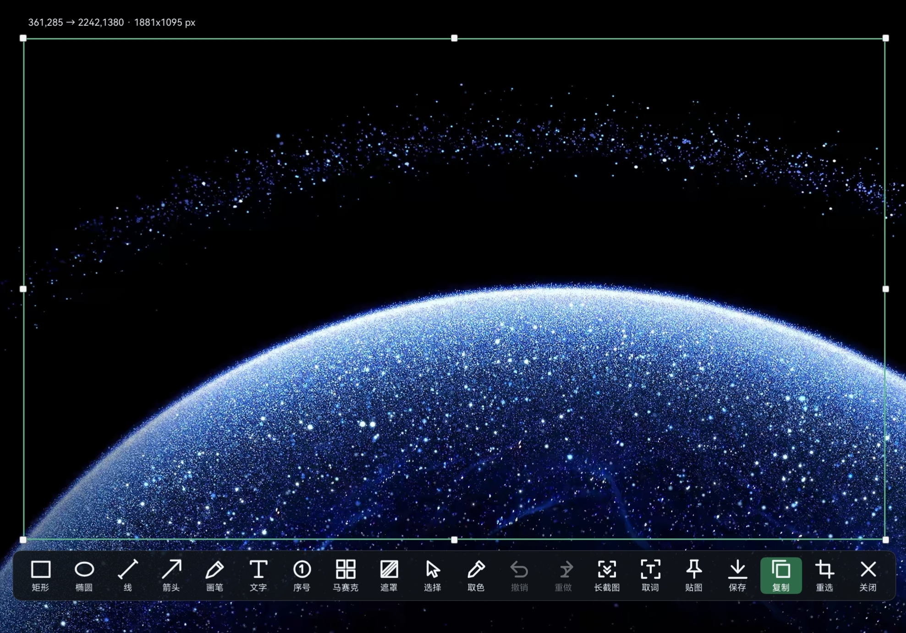
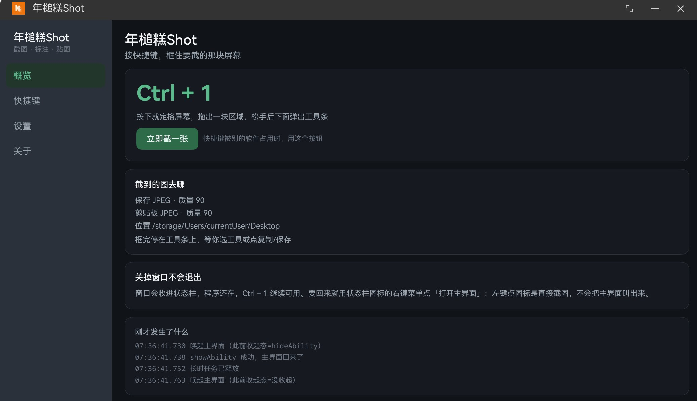
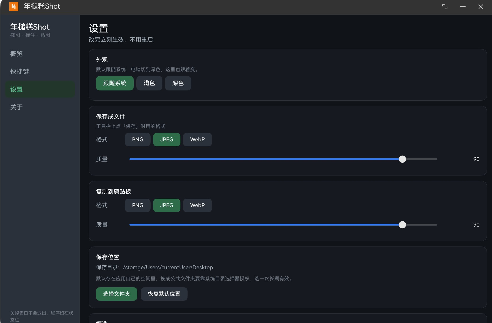

# 年槌糕Shot（NGshot）

鸿蒙 PC（HarmonyOS 2in1）上的截图工具。按一下 `Ctrl+1`，屏幕定格，拖出一块区域，就能在上面画框、加箭头、写字、打码，然后保存、复制、贴到桌面上，或者认出里面的文字。不截图的时候它收在状态栏，点图标就能截，关掉窗口也不退出。

界面和功能都按鸿蒙原生的方式实现，没有套网页壳，不带任何第三方库，也不联网。



## 怎么用

1. 按 `Ctrl+1`，或者点状态栏上的图标。
2. 屏幕定住，按住拖出一块区域，角上实时显示尺寸。
3. 松手，选区固定，旁边出现一条工具条。
4. 画完点「保存」或「复制」。也可以点「贴图」「取词」「长截图」。

不想截了就按 Esc、点右键，或者点工具条最右边的「关闭」——触屏没有前两个键，用最后一个。

## 功能

### 从按下快捷键到看见画面

在这台机器上大约半秒。最慢的那一步（把整屏压成 PNG）挪到了后台：截图出来的位图先直接铺上屏，你在拖框的时候它才慢慢编码，真要裁图时才等它。

窗口收在状态栏时，截出来的画面里没有自己；主界面开着时反过来——先截、再收窗，所以你能把自己的窗口一起截进去。截完框选结束，主界面会自动回来，不会把你扔在桌面上。

### 标注

工具条上一共 20 格：矩形、椭圆、直线、箭头、画笔、文字、序号、马赛克、遮罩、选择、取色、撤销、重做、长截图、取词、贴图、保存、复制、重选、关闭。

- 画图工具各自记自己的颜色和粗细（细 / 中 / 粗）；矩形和椭圆还分空心、实心，箭头还分实心、开口、双向三种头。
- 颜色一排九个常用色，点「更多」有 72 色；换个工具会记得它上次用的颜色。
- 文字是点哪打哪：选中文字工具，在选区里点一下就能打，看到的字号和颜色就是出图的字号和颜色。打到选区右边会自动换行，不会跑到框外面去。打完还想改，再点一下那段字就行；按住拖可以挪位置。
- 马赛克拖动时只显示一个虚线框，松手才真的打码——不然边拖边算会卡。
- 序号点一下就落一个圆点，编号自动往上加。
- 遮罩是半透明黑块，把这一块压暗、弱化背景，适合突出旁边的标注。它不是用来遮盖敏感信息的：框里的字只是变暗，放大或调一下对比度还能认出来。真要盖住内容，请用实心矩形（颜色选黑色）或马赛克。
- 选择工具能点中已经画的任意一笔，拖动、删除、上移下移、置顶置底都行；选中之后旁边那排颜色和粗细改的就是这一笔。
- 撤销、重做管住全部操作（最多 50 步），不是每种操作单独写一套回退。

选区定下来之后还能改：八个手柄拖边拖角，框里按住可以整体平移，方向键微调（按住 Ctrl 是 5px，Shift 是 10px），`Ctrl+A` 直接框整屏。改框的时候已经画的标注会跟着走，屏幕上的笔迹原地不动。

参考线（九宫格、黄金比例）和四角坐标只画在预览里，不会进到出图。

### 保存和复制

- 保存成 PNG / JPEG / WebP，文件名是 `NGshot-年月日-时分秒.扩展名`。
- 质量只对 JPEG 有效，PNG 和 WebP 是无损的，所以滑条只在 JPEG 时可拖。
- 保存位置可以自己挑目录，授权一次，之后每次启动都还记得。默认在应用自己的沙箱目录里。
- 复制到剪贴板会先按你设的格式和质量压一遍，粘出来的是压缩后的那张图。

自动动作可以在设置里定：松手就复制、就保存、就贴图，或者什么都不做停在工具条上。按住鼠标中键拖框，这一次就先不自动执行——中键要在松手之前按下。

### 贴图

选区可以变成一扇小窗摆在桌面上，位置和大小跟选区一模一样，同时贴好几张也行。按住能拖走，右键有复制、保存、取词、关闭。

贴图窗会置顶，压在其他应用上面，直到你把它关掉。

### 取词

对选区跑端侧文字识别，不需要权限，也不需要联网。

工具条上的「取词」认完直接把文字放进剪贴板，框选层不关，你还能接着保存或贴图。贴图窗右键菜单里的「取词」会弹一块结果面板，可以全选、复制全部、收起。

识别前会把图统一缩放到合适的尺寸，太小的图会认不出来；宽高比太夸张的长条会先垫一段白边再送进去，不然引擎会把一整行拆成好几段。

### 长截图

系统没给第三方做滚动截图的接口，模拟滚轮又要系统权限，所以这一版是「你滚、它拍」：每隔 300ms 拍一次同一条区域，按两帧的重叠把新内容接到图下面。

- 点「长截图」后，全屏层缩成角落里的一块小面板，不挡你，也不吃你的滚轮。左下角有实时预览，能看见长图一段段变长。
- 自己在目标窗口里往下滚，停一下它就自己接上；滚快了接不上，往回滚一点再停一下就行。
- 面板上「再抓一屏」手动补一帧，「完成」收尾出图（收尾前会自动补拍一帧，所以滚完马上点完成也不会漏最后一屏）。
- 采集时再按一次快捷键就是停止采集，Esc 也是收尾出图，不是丢掉。

长图最大64MB，太长的话建议分段截。

### 收在状态栏

- 点标题栏的 X 不是关掉，是收进状态栏。进程还在，快捷键照常可用。
- 点图标左键就是截图，主界面一帧都不露；要回主界面用右键菜单里的「打开主界面」。
- 退出也用右键菜单里那一项（系统自己加的那个）。
- 状态栏图标是自己画的一个字母 N，跟应用图标一个记号。

收起之后进程要一直活着，快捷键才叫得醒它，所以应用会申请一条长时任务。系统为此常驻一条「年槌糕Shot 正在运行计算任务，删除通知后任务将停止」的提示——这条提示由系统生成，文案改不了，也藏不掉，只在应用处于收起或后台状态时存在，回到主界面就消失。它右边那个 × 是可以按的，但按下去等于停掉长时任务：进程随后可能被系统冻结，`Ctrl+1` 就不再保证有反应，得先打开主界面把应用唤回来才恢复。

### 设置

主界面左边是导航、右边是内容，四栏：概览、快捷键、设置、关于。

- **外观**：跟随系统 / 浅色 / 深色，切换后所有窗口一起变。
- **输出**：保存和剪贴板各有自己的格式与质量，保存目录可以自己挑。
- **框选**：框选后自动动作、记忆上次的框（下次按同样的比例摆回）、参考线、四角坐标。
- **快捷键**：默认 `Ctrl+1`，可以改成 Ctrl / Shift / Alt 里的一个或两个，配字母、数字或者 F1–F12。改不上会退回原来的组合，不会出现「改了但没生效」。
- **日志**：设置页最下面有最近 30 行，出问题时可以复制出来。完整日志在应用沙箱的 `files/probe.log`。





## 几处不太直观的取舍

写这类工具时，有几段路看着能走，实际走不通，这里简单记录一下

- **不用系统的截图框选。** 系统的 `screenshot.pick()` 会卡死：既不出结果也不报错，系统侧留下的会话重装、重启进程都清不掉，只有重启设备能恢复。所以框选、取消、重选全是我们自己画的一层全屏窗口。
- **每个窗口都是独立的能力。** 主窗口收进状态栏以后，它名下的子窗口虽然还查得到，实际尺寸却是 0×0，屏幕上看不见。所以框选层、结果窗、贴图窗各自独立。
- **标注是「先截图，再在图上画」。** 试过把窗口做成透明遮罩直接盖在桌面上，能调用的三个透明接口全都调用成功，屏幕上依然是一层不透明的面。既然底图就是刚截下来的屏幕，铺上去画，效果一样、风险为零。
- **全屏层刚上屏那一瞬间没有键盘焦点。** 这时按 Esc 没反应，得先点一下窗口。第三方没有「主动要焦点」的公开接口，只能在窗口起来之后主动唤一次、再轮询有没有拿到。
- **一次鼠标按下会来两份事件**（鼠标一份、合成的触屏一份），所以拖动、开输入框这些动作要按「同一个点、短时间内的第二份」去重，不然会重复触发。
- **贴图不能是子窗口，但可以置顶。** 子窗口调置顶会报错（1300004），跨应用全局悬浮窗（`TYPE_FLOAT`）要受限权限（201）；而贴图是独立能力的主窗口，`setWindowTopmost(true)` 在它身上是能用的，所以贴图会压在其他应用上面。

## 已知限制

- **只在 2in1（PC）上能用。** 截屏、托盘、置顶都是 PC 能力，其他形态会直接报不支持，代码里也没做适配。
- **鼠标穿透没做。** 真正的开关是受限权限，接口起始版本也高于本工程的 SDK 基线，申请场景还限定厂商，所以不把它当前提。
- **顶部状态栏关不掉。** PC 上第三方应用收不起系统状态栏，所以框选层按整屏铺，让底图里那条状态栏和屏幕上的那条对齐。
- **长截图要自己滚**，滚太快会丢帧。
- **录屏、GIF 不做。** 系统录屏接口只给文件，不给出流。
- **同一时间只能截一张。** 流程走到一半再按快捷键，只会告诉你现在卡在哪一步。

## 环境与构建

- HarmonyOS 2in1，编译与兼容 SDK 都是 `6.1.0(23)`（API 23）。
- 只在 HUAWEI MateBook Pro（3120×2080，缩放约 1.9）上实测过。
- 申请的权限只有几条：截屏、窗口置顶、后台常驻（收起后快捷键还能用）、保存目录的持久授权。

用 DevEco Studio 打开本目录，在 `File > Project Structure` 里补签名就能运行。带签名的 `build-profile.json5` 不入库，仓库里给的是模板 `build-profile.example.json5`，复制一份改名后填 `signingConfigs`。

第一次按快捷键会弹截屏授权，通过后不再打扰。

工程没有额外的构建脚本，也不带CI，编译就用DevEco Studio自带的 hvigor。

## 目录结构

```
NGshot/
├─ AppScope/                     应用级资源：图标、应用名
├─ entry/src/main/
│  ├─ module.json5               四个 UIAbility + 权限声明
│  ├─ ets/
│  │  ├─ entryability/           主窗、框选层、结果窗、贴图窗（各是一个能力）
│  │  ├─ pages/                  主界面、框选标注页、结果窗页、贴图页
│  │  ├─ views/                  概览 / 快捷键 / 设置 / 关于 四栏
│  │  ├─ common/                 截图流程、图片编解码、标注、长截图、识别、设置、托盘等
│  │  └─ probe/                  全局快捷键订阅与运行日志
│  └─ resources/                 深浅色两套颜色、启动页配置、页面路由
├─ assets/screenshots/           README 里的截图
├─ tools/make-icon.js            图标生成脚本
├─ LICENSE                       Apache License 2.0 全文
├─ NOTICE                        版权与来源声明
└─ build-profile.example.json5   构建配置模板
```

几个比较关键的文件：`common/ShotFlow.ets` 管一次截图的先后顺序，`common/ShotService.ets` 管那份图片字节（裁剪、编码、保存、进剪贴板），`common/MarkService.ets` 是标注的命令表和出图时画像素的地方，`pages/SelectPage.ets` 是框选层和工具条本身。

## 参考

功能清单和交互形态参考了 [eSearch](https://github.com/xushengfeng/eSearch) 的公开特性表；长截图的帧间匹配思路也受其公开实现（GPL-3.0）启发，按 ArkTS 重写，未复制其代码。图标和名称都是自己的。

平台接口的起始版本、所需权限、错误码、支持的设备范围，都对着华为官方开发者文档核过；文档和实机对不上时以实机为准。

## 许可证

[Apache License 2.0](LICENSE) © 2026 niangao

可以自由使用、修改、分发，包括商业用途；条件是保留版权与许可声明、随分发附带 `LICENSE` 和 [`NOTICE`](NOTICE)、并在修改过的文件里注明改动。许可不提供任何担保，也不授予商标使用权。
